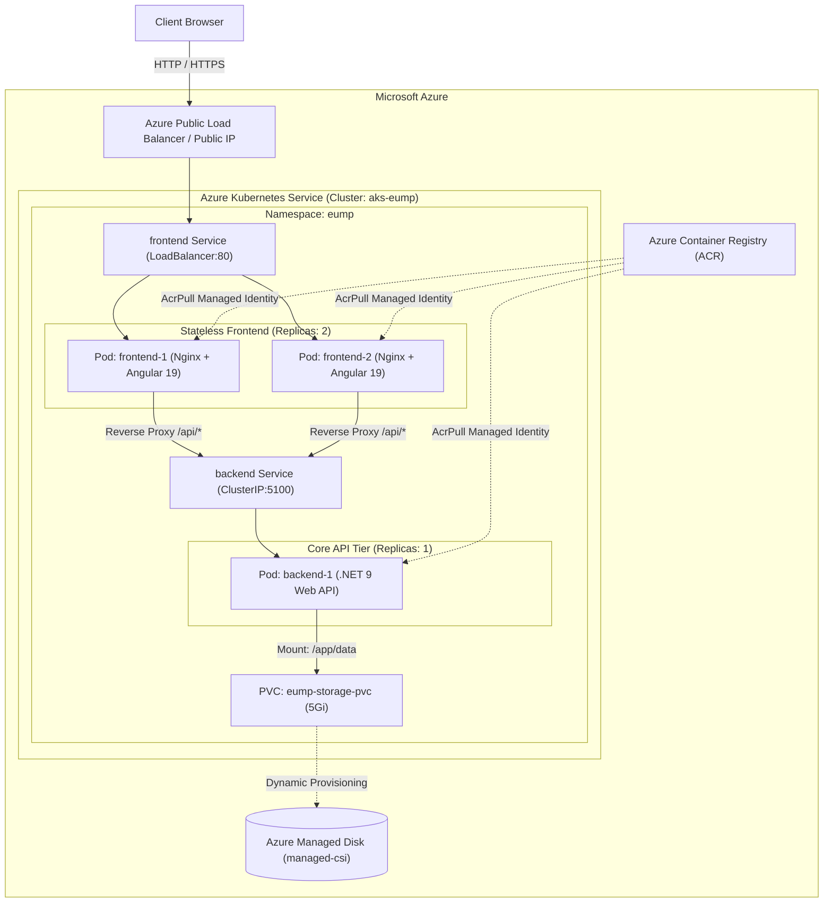

# Azure Kubernetes Service (AKS) Deployment & Azure Portal Guide

This guide provides end-to-end instructions for deploying the **Enterprise User Management Platform (EUMP)** to **Azure Kubernetes Service (AKS)**, detailing what to configure manually in the **Azure Portal** and how to run the deployment scripts.

---

## 1. High-Level AKS Architecture



---

## 2. What You Need to Do Manually in Azure Portal

Follow these step-by-step instructions in the [Azure Portal](https://portal.azure.com).

### Step 1: Create a Resource Group
1. In the search bar at the top of Azure Portal, type **Resource groups** and select it.
2. Click **+ Create**.
3. Fill in the parameters:
   - **Subscription**: Select your active Azure subscription.
   - **Resource group**: `rg-eump` (or your preferred name).
   - **Region**: Choose a region close to your users (e.g., `East US`, `West Europe`, `Central India`).
4. Click **Review + create** -> **Create**.

---

### Step 2: Create an Azure Container Registry (ACR)
An ACR is required to host your custom Docker container images securely in Azure.

1. In the top search bar, search for **Container registries** and select it.
2. Click **+ Create**.
3. Fill in the parameters on the **Basics** tab:
   - **Subscription**: Your Azure subscription.
   - **Resource group**: Select `rg-eump`.
   - **Registry name**: Enter a globally unique name (e.g., `acreump<yourname>`, lowercase letters & numbers only, 5-50 characters).
   - **Location**: Same region as your resource group (e.g., `East US`).
   - **SKU**: Select **Basic** (cost-effective for learning and testing).
4. Click **Review + create** -> **Create**.
5. Once created, go to the resource:
   - In the left sidebar under **Settings**, click **Access keys**.
   - Check **Admin user** to enable it (useful for local `docker login`, though AKS will use Managed Identity).
   - Note down the **Login server** (e.g., `acreump123.azurecr.io`).

---

### Step 3: Create the Azure Kubernetes Service (AKS) Cluster
1. In the top search bar, search for **Kubernetes services** and select it.
2. Click **+ Create** -> **Create a Kubernetes cluster**.
3. Configure the tabs as follows:

#### **Tab 1: Basics**
- **Subscription**: Your subscription.
- **Resource group**: Select `rg-eump`.
- **Cluster preset configuration**: Choose **Dev/Test** (or Cost-Optimized).
- **Kubernetes cluster name**: `aks-eump`.
- **Region**: Same region as your resource group (e.g., `East US`).
- **Kubernetes version**: Select the default recommended version (1.29+ / 1.30+).
- **Automatic upgrade**: Recommended or Disabled.
- **Node pools**:
  - Click on the default `agentpool` or change node size:
  - **Node size**: Choose `Standard_B2s` (2 vCPUs, 4 GiB RAM - economical for dev/test) or `Standard_D2s_v5`.
  - **Scale method**: Manual.
  - **Node count**: `1` or `2` nodes.

#### **Tab 2: Node pools**
- Keep default settings.

#### **Tab 3: Access**
- **Authentication method**: **System-assigned managed identity** (default & recommended).
- **Kubernetes authorization**: **Local accounts with Kubernetes RBAC** or **Azure AD authentication with Kubernetes RBAC**.

#### **Tab 4: Networking**
- **Network configuration**: **Azure CNI Node Subnet** or **Kubenet** (Kubenet is great and economical for small clusters).
- **DNS name prefix**: `aks-eump-dns`.
- **Load balancer**: **Standard** (default).

#### **Tab 5: Integrations (CRITICAL STEP)**
- **Container registry**: Click the dropdown and select the **Azure Container Registry** created in Step 2 (`acreump<yourname>`).
  > **Note**: This automatically creates the `AcrPull` role assignment in Azure AD/Entra, allowing the AKS cluster to securely pull your Docker images without needing Kubernetes image pull secrets!

#### **Tab 6: Monitoring (Optional)**
- **Container insights**: Enable if you want Azure Monitor metrics (optional; uncheck if you want to minimize costs).

4. Click **Review + create** -> Click **Create**.
   *(Creation usually takes 4-7 minutes).*

---

### Step 4: Verify ACR Integration (If Not Done During Cluster Creation)
If you already had an existing AKS cluster or skipped the Integrations tab:
1. In Azure Portal, navigate to your AKS cluster `aks-eump`.
2. Under **Settings** on the left menu, select **Container registry**.
3. Click **Connect container registry**, select your ACR (`acreump...`), and click **Connect**.

---

### Step 5: (Optional) View Cluster Resources in Azure Portal
Once deployed, Azure Portal provides a complete visual dashboard for your Kubernetes cluster:
1. Open your AKS cluster `aks-eump`.
2. In the left navigation bar under **Kubernetes resources**:
   - **Namespaces**: You will see `eump` once deployed.
   - **Workloads**: View the state of `backend-deployment` and `frontend-deployment`.
   - **Services and ingresses**: View the `frontend` LoadBalancer service and its **External IP**.
   - **Storage**: View the `eump-storage-pvc` PersistentVolumeClaim.

---

## 3. Automated Deployment via Azure DevOps CI/CD

The recommended industry-standard method for deploying to AKS is via the **Azure DevOps multi-stage pipeline** (`azure-pipelines.yml`).

See the complete [Azure DevOps CI/CD Guide](azure-devops-cicd-guide.md) for step-by-step instructions:
1. Automated CI: Runs .NET 9 unit/integration tests with Cobertura code coverage and Angular 19 production build verification.
2. Automated Image Builds: Builds and pushes Docker images to ACR with immutable `$(Build.BuildId)` tags.
3. Automated CD: Deploys manifests to AKS under the `eump-production` environment with automated rollout verification and optional approval gates.

---

## 4. Manual Deployment via Azure CLI / Cloud Shell

If you prefer deploying step-by-step or using Azure Cloud Shell:

### 1. Login & Connect kubectl to AKS:
```bash
az login
az aks get-credentials --resource-group rg-eump --name aks-eump --overwrite-existing
```

### 2. Build and Push Images using ACR Cloud Build (No local Docker needed!):
If you do not have Docker installed locally, you can let Azure build the images in the cloud:
```bash
# Build backend in ACR:
az acr build --registry <acrName> --image eump-backend:latest ./backend

# Build frontend in ACR:
az acr build --registry <acrName> --image eump-frontend:latest ./frontend/enterprise-user-management-ui
```

### 3. Deploy Manifests:
```bash
# Apply namespace
kubectl apply -f kubernetes/00-namespace.yaml

# Apply storage (Azure Disk standard CSI driver)
kubectl apply -f kubernetes/01-storage.yaml

# Apply ConfigMap & Secret
kubectl apply -f kubernetes/02-configmap.yaml
kubectl apply -f kubernetes/03-secret.yaml

# Apply Backend Deployment (Update image name to your ACR login server)
kubectl apply -f kubernetes/04-backend-deployment.yaml

# Apply Backend Service
kubectl apply -f kubernetes/05-backend-service.yaml

# Apply Frontend Deployment
kubectl apply -f kubernetes/06-frontend-deployment.yaml

# Apply Frontend LoadBalancer Service
kubectl apply -f kubernetes/07-frontend-service.yaml
```

### 4. Check Public IP:
```bash
kubectl get svc frontend -n eump -w
```
Once the `EXTERNAL-IP` transitions from `<pending>` to a public IP (e.g. `20.55.120.45`):
- Open `http://<EXTERNAL-IP>` in your browser to access the Angular application.
- Open `http://<EXTERNAL-IP>/swagger` to view interactive OpenAPI / Scalar API documentation.

---

## 5. Summary of Code & Manifest Adjustments Made for AKS

| Component | File Changed | Purpose for AKS |
| :--- | :--- | :--- |
| **Backend API** | `Program.cs` | Disabled internal HTTPS redirection behind cluster ingress to prevent Kubernetes health probe failure (`307 Redirect`); configured `ForwardedHeadersOptions`; dynamic CORS. |
| **Frontend UI** | `app.component.html` & `proxy.conf.json` | Changed API Docs link from hardcoded `localhost:5100` to relative `/swagger`, which routes through Nginx reverse proxy on AKS. |
| **Storage PVC** | `01-storage.yaml` | Adjusted requested storage to `5Gi` (standard minimum for Azure Managed Disks dynamic volume creation in AKS). |
| **Azure Files Option** | `01-storage-azurefile.yaml` | Added optional Azure Files storage claim (`azurefile-csi`) for `ReadWriteMany` support and fast cross-node pod rescheduling. |
| **ConfigMap** | `02-configmap.yaml` | Added `EnableSwagger: "true"`, `EnableHttpsRedirection: "false"`, `ASPNETCORE_FORWARDEDHEADERS_ENABLED: "true"`. |
| **Backend Deployment** | `04-backend-deployment.yaml` | Added `securityContext: fsGroup: 1654` to give non-root .NET 9 container write permissions on mounted Azure Disks/Files; adjusted health probe timeouts. |
| **Frontend Service** | `07-frontend-service.yaml` | Removed hardcoded `nodePort: 30080` to allow Azure Public Load Balancer dynamic port allocation without conflicts. |
| **Ingress** | `08-ingress.yaml` | Upgraded to modern `spec.ingressClassName: nginx` / AKS Web App Routing spec. |
| **CI/CD Pipeline** | `azure-pipelines.yml` | Multi-stage Azure DevOps pipeline with unit testing, ACR image builds, and automated rollout to AKS. |

---

## 6. Troubleshooting Common AKS Issues

### Issue 1: Pod stuck in `ImagePullBackOff`
- **Cause**: AKS does not have permission to pull images from ACR, or image name is misspelled.
- **Fix**: Run:
  ```bash
  az aks update -n <AksClusterName> -g <ResourceGroupName> --attach-acr <AcrName>
  ```

### Issue 2: Backend Pod fails Readiness Probe (`/health/ready` 503)
- **Cause**: The mounted persistent storage directory `/app/data` is owned by `root:root` and the non-root .NET container cannot write `users.json`.
- **Fix**: Verify that `securityContext: fsGroup: 1654` is present in `04-backend-deployment.yaml`.

### Issue 3: Frontend External-IP stays `<pending>`
- **Cause**: Azure Public Load Balancer is still provisioning the Public IP resource in your Azure Subscription.
- **Fix**: Wait 1 to 2 minutes. Check if your Azure subscription has reached its Public IP address quota for the region.

### Issue 4: Browsing `/swagger` returns 404 or connection error
- **Cause**: Nginx reverse proxy routing or `EnableSwagger` flag.
- **Fix**: In `02-configmap.yaml`, ensure `EnableSwagger: "true"` is set, and ensure Nginx is configured to proxy `/swagger` and `/scalar/`.

