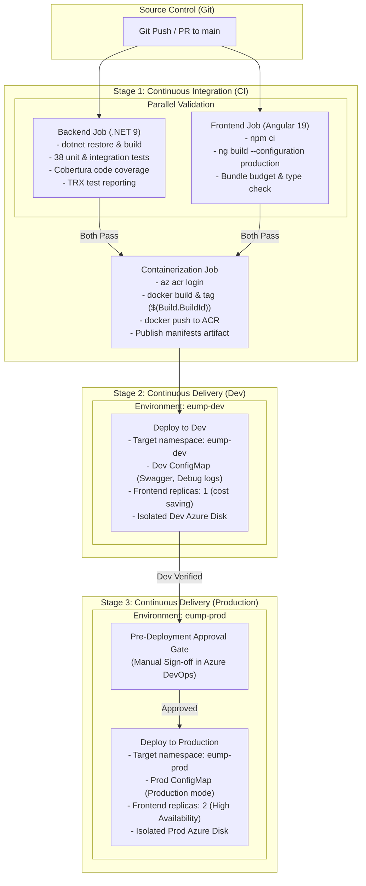

# Azure DevOps CI/CD Guide for Azure Kubernetes Service (AKS)

This guide details the **industry-standard CI/CD pipeline** implemented for the **Enterprise User Management Platform (EUMP)** using **Azure DevOps Pipelines**, **Azure Container Registry (ACR)**, and **Azure Kubernetes Service (AKS)**.

---

## 1. Pipeline Architecture & Workflow



---

## 2. Industry Standards Implemented

| Practice | Implementation | Why It Matters |
| :--- | :--- | :--- |
| **Multi-Environment Promotion** | Dev (`eump-dev`) $\rightarrow$ Prod (`eump-prod`) | Code is automatically verified in an isolated Dev environment before being promoted to Production. |
| **Pipeline as Code** | `azure-pipelines.yml` stored directly in Git repository | Version controlled, auditable, and reviewed like any other software code. |
| **Separation of CI & CD** | Multi-stage pipeline (`BuildAndTest` -> `DeployToDev` -> `DeployToProd`) | Prevents deploying code if unit/integration tests or build validation fail. |
| **Immutable Build Tags** | `$(Build.BuildId)` (e.g. `1042`) used for image tags alongside `latest` | The exact same container image tested in Dev is promoted to Prod. Never deploy solely `:latest`. |
| **Automated Test Reporting** | `PublishTestResults@2` + `PublishCodeCoverageResults@2` | Visual pass/fail graphs and code coverage statistics displayed directly in the Azure DevOps **Tests** and **Code Coverage** tabs. |
| **Azure DevOps Environment Gates** | Environments `eump-dev` and `eump-prod` | Automatic deployment to Dev; manual sign-off required before deploying to Production. |
| **PR Validation Isolation** | `condition: and(succeeded(), ne(variables['Build.Reason'], 'PullRequest'))` | Pull requests execute tests and build checks without pushing images to ACR or modifying any cluster. |
| **Storage & Data Isolation** | Separate PVCs in `eump-dev` and `eump-prod` | Dev and Prod have completely isolated Azure Managed Disks. Dev testing will never affect production data. |

---

## 3. What You Need to Do in Azure DevOps (Step-by-Step)

Follow these steps in your [Azure DevOps Portal](https://dev.azure.com):

### Step 1: Create the Azure Resource Manager Service Connection
This allows Azure DevOps to securely communicate with your Azure subscription, ACR, and AKS.

1. In Azure DevOps, go to **Project Settings** (bottom-left corner) -> **Service connections**.
2. Click **New service connection**.
3. Select **Azure Resource Manager** -> Click **Next**.
4. Choose **Workload Identity federation (automatic)** (recommended) or **Service principal (automatic)** -> Click **Next**.
5. Configure:
   - **Scope level**: Subscription
   - **Subscription**: Select your active Azure subscription.
   - **Resource group**: Select `rg-eump` (the resource group containing your AKS and ACR).
   - **Service connection name**: Enter `azure-rm-connection` (this matches `azureServiceConnection` in `azure-pipelines.yml`).
   - Check **Grant access permission to all pipelines**.
6. Click **Save**.

---

### Step 2: Create the Pipeline Environments (Dev & Prod)

You need to create two environments in Azure DevOps:
1. **`eump-dev`**: For automated continuous deployment to the Dev namespace.
2. **`eump-prod`**: For gated continuous deployment to the Production namespace.

#### Create Dev Environment:
1. In the left navigation menu, go to **Pipelines** -> **Environments**.
2. Click **New environment**.
3. **Name**: Enter `eump-dev`.
4. **Resource**: Select **None** -> Click **Create**.

#### Create Production Environment with Approval Gate:
1. In **Pipelines** -> **Environments**, click **New environment**.
2. **Name**: Enter `eump-prod`.
3. **Resource**: Select **None** -> Click **Create**.
4. **Add Approval Gate**:
   - In the top-right corner of the `eump-prod` screen, click the three dots (`...`) -> **Approvals and checks**.
   - Click **+** -> **Approvals**.
   - Add yourself or your team leads as designated approvers.
   - Click **Create**.

> **How it works in practice**: When you merge code to `main`, Stage 1 (CI) builds and tests the app, Stage 2 (Dev) deploys automatically to `eump-dev`. Stage 3 (Prod) pauses, sends an approval notification, and only deploys to `eump-prod` once approved!

---

### Step 3: Create and Run the Pipeline
1. In the left menu, go to **Pipelines** -> **Pipelines**.
2. Click **New pipeline** (or **Create Pipeline**).
3. Select where your code is hosted:
   - **Azure Repos Git** (or **GitHub**).
4. Select your repository: `EnterpriseUserManagementPlatform`.
5. Select **Existing Azure Pipelines YAML file**.
6. **Path**: Select `/azure-pipelines.yml` -> Click **Continue**.
7. In the pipeline editor, review the variables at the top:
   ```yaml
   variables:
     azureServiceConnection: 'azure-rm-connection'
     azureResourceGroup: 'rg-eump'
     aksClusterName: 'aks-eump'
     acrName: 'acreump123' # Update to your exact ACR name
   ```
8. Click **Save and run** (or click **Save**).

---

### Step 4: Configure Branch Policies (Pull Request Gate)
To enforce quality standards on every code change:
1. In Azure DevOps, go to **Repos** -> **Branches**.
2. Hover over the `main` branch -> Click the three dots (`...`) -> **Branch policies**.
3. Under **Build Validation**, click **+ Add build policy**.
4. **Build pipeline**: Select the pipeline you created.
5. **Trigger**: Automatic.
6. Click **Save**.
   > Every Pull Request to `main` will now automatically run the backend tests and Angular compilation. Merging will only be allowed when all tests pass!

---

## 4. Pipeline Execution Summary

### On Pull Request (PR):
- Runs **Backend_CI** (.NET 9 build, 38 unit & integration tests, code coverage).
- Runs **Frontend_CI** (Angular 19 compilation, bundle budgets).
- **Skips** image push and deployment (cluster remains untouched).

### On Push / Merge to `main`:
1. Executes **Backend_CI** and **Frontend_CI** in parallel.
2. If both pass, executes **Container_Build_And_Push**:
   - Builds backend Docker image -> Tags as `<acr>.azurecr.io/eump-backend:$(Build.BuildId)` and `:latest`.
   - Builds frontend Docker image -> Tags as `<acr>.azurecr.io/eump-frontend:$(Build.BuildId)` and `:latest`.
   - Pushes both images to your ACR.
   - Publishes Kubernetes manifests as an artifact.
3. Triggers **DeployToAKS** stage:
   - Prompts for approval (if configured on the `eump-production` environment).
   - Injects the immutable build tag into `04-backend-deployment.yaml` and `06-frontend-deployment.yaml`.
   - Applies the manifests in order to namespace `eump`.
   - Validates that both backend and frontend pods roll out cleanly without timeouts.
   - Prints the assigned Azure Public Load Balancer IP address.

---

## 5. Verification & Monitoring in Azure DevOps

- **Test Results Tab**: View full test execution times, pass/fail status, and stack traces.
- **Code Coverage Tab**: View coverage percentages across Domain, Application, Infrastructure, and API layers.
- **Environments View**: Go to **Pipelines** -> **Environments** -> `eump-production` to see which build commit is currently live in your AKS cluster, view deployment history, or trigger a rollback to any previous build.

