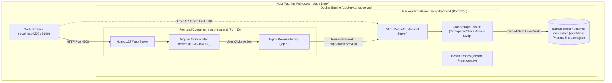
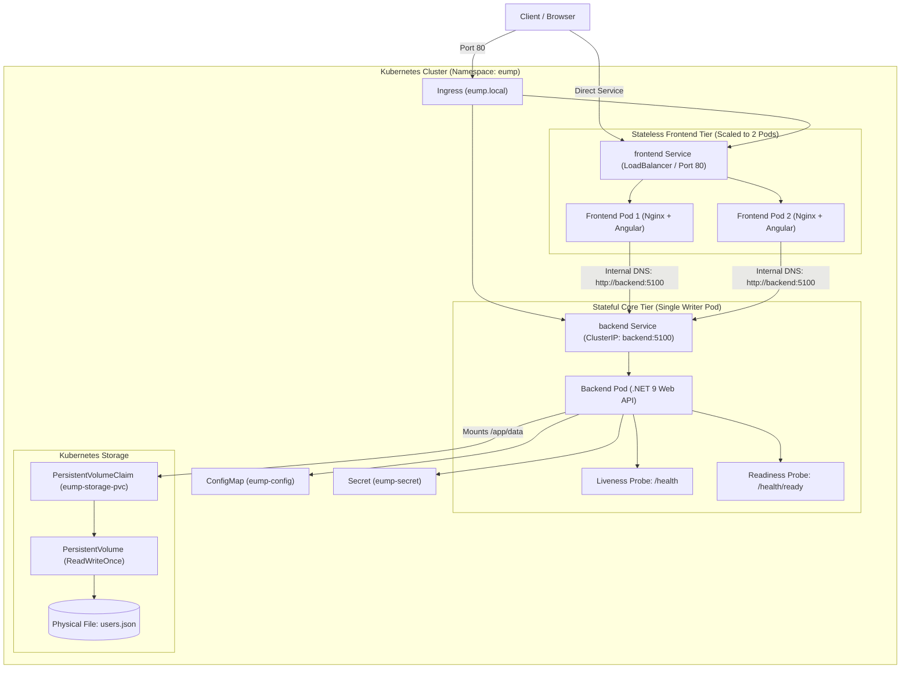

# Complete Guide: Containers and Kubernetes in EUMP

This document explains **Containers (Docker)** and **Kubernetes (K8s)** and details **how they work together in the Enterprise User Management Platform (EUMP)**.

---

## 1. Core Concepts Explained Simply

| Concept | What It Is | Role in EUMP |
| :--- | :--- | :--- |
| **Container (Docker)** | A lightweight, standalone package that contains everything needed to run an application (code, runtime, system libraries, configuration). | Packages our .NET 9 API and Angular 19 SPA into self-contained units that run identically on any machine without installing .NET SDK or Node.js. |
| **Docker Compose** | A tool for defining and running multi-container Docker applications on a **single machine** using a single YAML file (`docker-compose.yml`). | Runs both backend and frontend containers together locally, connects them on a private bridge network, and attaches persistent storage. |
| **Kubernetes (K8s)** | An enterprise **container orchestrator** designed to manage, scale, self-heal, and network containers across a **cluster of machines**. | Automates health monitoring, auto-restarts failed pods, manages persistent volume claims, and enables horizontal scaling of the web tier. |

---

## 2. How Docker Containers Work in This Project

> [!TIP]
> A Word document version of this complete guide with embedded high-resolution diagrams is available at [`docs/Containers-and-Kubernetes-Guide.docx`](file:///c:/Users/Nagarajan/source/repos/EnterpriseUserManagementPlatform/docs/Containers-and-Kubernetes-Guide.docx).


In our project, we have two custom container images, each built using a **multi-stage Dockerfile**:



### 1. The Backend Container (`eump-backend`)
- **Base Runtime:** `mcr.microsoft.com/dotnet/aspnet:9.0` (Debian Linux slim).
- **Size:** ~344 MB (contains only the lightweight runtime; the 1 GB+ .NET SDK was used only in Stage 1 and discarded).
- **Security:** Runs as a non-root user (`USER $APP_UID`, UID 1654).
- **Physical Storage:**
  - Mounts the persistent volume to `/app/data`.
  - Every write goes to `/app/data/users.json` using an in-process thread lock (`SemaphoreSlim`) and atomic temporary swap (`users.json.tmp` $\rightarrow$ `users.json`).
  - **No SQL Database:** Data is physically stored in JSON files on disk.

### 2. The Frontend Container (`eump-frontend`)
- **Base Runtime:** `nginx:1.27-alpine` (Alpine Linux).
- **Size:** ~75 MB (extremely small).
- **No Node.js in Runtime:** Node.js 20 was used only in Stage 1 to build the Angular bundle; the final container has **zero Node.js overhead**.
- **Two Critical Jobs handled by Nginx:**
  1. **HTML5 PushState Routing:** Angular is a Single Page Application. If you refresh `http://localhost:4200/users`, Nginx catches the request and rewrites it to `/index.html` via `try_files $uri $uri/ /index.html;`, allowing the Angular router to display the page without 404 errors.
  2. **Internal API Reverse Proxy:** When the browser requests `/api/users`, Nginx forwards it to `http://backend:5100/api/users` over the private Docker network (`eump-network`). This **completely eliminates CORS errors**.

---

## 3. End-to-End Request Lifecycle & Low-Level Architecture


Here is what happens when a user opens the application:

```text
Step 1: User types http://localhost:4200 in their browser.
Step 2: Request hits Nginx inside the Frontend container on port 80 (mapped to host 4200).
Step 3: Nginx returns index.html, main-*.js, and styles-*.css. The Angular 19 SPA boots in the browser.
Step 4: Angular calls UserService.getUsers().
Step 5: Browser sends GET /api/users to http://localhost:4200/api/users.
Step 6: Nginx detects the /api/ prefix in nginx.conf and proxies the request to http://backend:5100/api/users.
Step 7: The .NET 9 API Kestrel server inside the Backend container receives the request.
Step 8: UsersController calls UserService -> JsonUserRepository -> JsonStorageService.
Step 9: JsonStorageService reads /app/data/users.json from the persistent volume, deserializes the JSON into C# User entities, applies filtering and pagination, and returns an ApiResponse<PagedResult<UserDto>>.
Step 10: Response travels back: Backend -> Nginx -> Browser -> Angular updates the UI table.
```

---

## 4. How Kubernetes Works with Our Project

While Docker Compose runs containers on **one computer**, Kubernetes manages them across **clusters of servers** with automated self-healing, storage binding, and scaling.



### The 8 Kubernetes Building Blocks in EUMP:

1. **Namespace ([`00-namespace.yaml`](file:///c:/Users/Nagarajan/source/repos/EnterpriseUserManagementPlatform/kubernetes/00-namespace.yaml)):**
   - Creates an isolated space called `eump` so our application doesn't interfere with other workloads in the cluster.

2. **PersistentVolumeClaim ([`01-storage.yaml`](file:///c:/Users/Nagarajan/source/repos/EnterpriseUserManagementPlatform/kubernetes/01-storage.yaml)):**
   - Requests a 1 GB persistent disk from the Kubernetes storage provider.
   - Uses **`accessModes: [ReadWriteOnce]`** to guarantee dedicated read/write access for our physical JSON storage.

3. **ConfigMap & Secret ([`02-configmap.yaml`](file:///c:/Users/Nagarajan/source/repos/EnterpriseUserManagementPlatform/kubernetes/02-configmap.yaml), [`03-secret.yaml`](file:///c:/Users/Nagarajan/source/repos/EnterpriseUserManagementPlatform/kubernetes/03-secret.yaml)):**
   - Injects configuration (`JsonStorage__StorageDirectory=/app/data`, `ASPNETCORE_URLS=http://+:5100`) without hardcoding them into Docker images.

4. **Backend Deployment ([`04-backend-deployment.yaml`](file:///c:/Users/Nagarajan/source/repos/EnterpriseUserManagementPlatform/kubernetes/04-backend-deployment.yaml)):**
   - Runs our .NET 9 API image.
   - **Why `replicas: 1`?** Because physical JSON storage uses in-process thread locking (`SemaphoreSlim`). Having 1 replica ensures single-writer safety and prevents race conditions, while Kubernetes provides high availability by automatically restarting the pod if it ever crashes.
   - **Probes:**
     - **Liveness Probe (`/health`):** Restarts the pod if the .NET process hangs.
     - **Readiness Probe (`/health/ready`):** Only routes traffic to the pod after it verifies that `/app/data/users.json` is healthy and accessible.

5. **Backend Service ([`05-backend-service.yaml`](file:///c:/Users/Nagarajan/source/repos/EnterpriseUserManagementPlatform/kubernetes/05-backend-service.yaml)):**
   - Creates an internal `ClusterIP` named `backend`.
   - Kubernetes internal DNS automatically resolves `http://backend:5100` to the backend pod's internal IP.

6. **Frontend Deployment ([`06-frontend-deployment.yaml`](file:///c:/Users/Nagarajan/source/repos/EnterpriseUserManagementPlatform/kubernetes/06-frontend-deployment.yaml)):**
   - Runs **2 replicas** of the Nginx + Angular 19 frontend.
   - Because the frontend is completely stateless, it can scale to 2, 5, or 20 pods seamlessly.

7. **Frontend Service ([`07-frontend-service.yaml`](file:///c:/Users/Nagarajan/source/repos/EnterpriseUserManagementPlatform/kubernetes/07-frontend-service.yaml)):**
   - Exposes the frontend outside the cluster via `type: LoadBalancer` (or `NodePort: 30080`), making it directly reachable from your browser at `http://localhost:80`.

8. **Ingress ([`08-ingress.yaml`](file:///c:/Users/Nagarajan/source/repos/EnterpriseUserManagementPlatform/kubernetes/08-ingress.yaml)):**
   - Provides clean domain routing rules (`eump.local`) routing `/` to the frontend and `/api` to the backend.

---

## 5. Comparison: Docker Compose vs. Kubernetes

| Feature | Docker Compose | Kubernetes |
| :--- | :--- | :--- |
| **Scope** | Single machine / developer laptop | Multi-node cluster / enterprise production |
| **Configuration** | Single file: `docker-compose.yml` | Declarative YAML manifests (`kubernetes/*.yaml`) |
| **Data Storage** | Docker Named Volume (`eump-data`) | PersistentVolumeClaim (`eump-storage-pvc`) |
| **Self-Healing** | `restart: unless-stopped` | Liveness/Readiness probes + automatic pod rescheduling |
| **Frontend Scaling** | Manual (`docker compose up --scale frontend=2`) | Native `replicas: 2` or Horizontal Pod Autoscaler (HPA) |
| **How to run** | `docker compose up -d` | `.\kubernetes\k8s-deploy.ps1 -Action Apply` |

---

## 6. Verification Commands Cheat Sheet

### Docker Compose
```powershell
# 1. Start containers in background
docker compose up -d

# 2. Check running status
docker compose ps

# 3. View live logs
docker compose logs -f backend

# 4. Inspect physical JSON file inside container volume
docker exec -it eump-backend cat /app/data/users.json

# 5. Stop containers (preserves data)
docker compose down
```

### Kubernetes (Docker Desktop / Minikube)
```powershell
# 1. Deploy all manifests
.\kubernetes\k8s-deploy.ps1 -Action Apply

# 2. View all pods, services, and storage claims
kubectl get all,pvc -n eump

# 3. Inspect backend pod logs
kubectl logs -l app.kubernetes.io/component=backend -n eump

# 4. Inspect frontend pod logs
kubectl logs -l app.kubernetes.io/component=frontend -n eump

# 5. Teardown
.\kubernetes\k8s-deploy.ps1 -Action Delete
```

