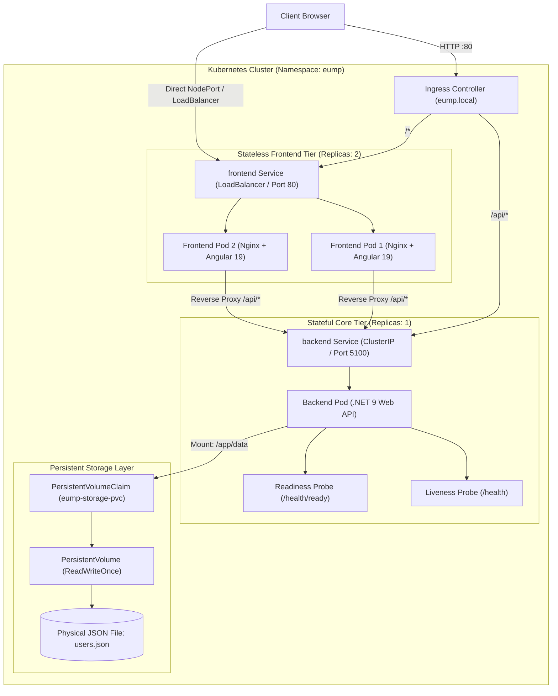

# Kubernetes Architecture & Storage Design

This document details the deployment topology, persistence strategy, and scaling considerations for running the **Enterprise User Management Platform (EUMP)** on Kubernetes.

---

## 1. High-Level Cluster Topology



---

## 2. Manifest Inventory

All declarative manifests reside in the [`kubernetes/`](file:///c:/Users/Nagarajan/source/repos/EnterpriseUserManagementPlatform/kubernetes) directory:

| Manifest | Kind | Purpose |
| :--- | :--- | :--- |
| [`00-namespace.yaml`](file:///c:/Users/Nagarajan/source/repos/EnterpriseUserManagementPlatform/kubernetes/00-namespace.yaml) | `Namespace` | Creates isolated namespace `eump`. |
| [`01-storage.yaml`](file:///c:/Users/Nagarajan/source/repos/EnterpriseUserManagementPlatform/kubernetes/01-storage.yaml) | `PersistentVolumeClaim` | Requests 1Gi volume with `ReadWriteOnce` access mode for JSON files. |
| [`02-configmap.yaml`](file:///c:/Users/Nagarajan/source/repos/EnterpriseUserManagementPlatform/kubernetes/02-configmap.yaml) | `ConfigMap` | Decouples environment variables (`ASPNETCORE_URLS`, `JsonStorage__*`). |
| [`03-secret.yaml`](file:///c:/Users/Nagarajan/source/repos/EnterpriseUserManagementPlatform/kubernetes/03-secret.yaml) | `Secret` | Stores sensitive secrets out of source code. |
| [`04-backend-deployment.yaml`](file:///c:/Users/Nagarajan/source/repos/EnterpriseUserManagementPlatform/kubernetes/04-backend-deployment.yaml) | `Deployment` | Runs the .NET 9 API with `replicas: 1`, PVC mount, and health probes. |
| [`05-backend-service.yaml`](file:///c:/Users/Nagarajan/source/repos/EnterpriseUserManagementPlatform/kubernetes/05-backend-service.yaml) | `Service` | Internal `ClusterIP` named `backend` (resolvable via CoreDNS). |
| [`06-frontend-deployment.yaml`](file:///c:/Users/Nagarajan/source/repos/EnterpriseUserManagementPlatform/kubernetes/06-frontend-deployment.yaml) | `Deployment` | Runs the Nginx + Angular 19 SPA with `replicas: 2`. |
| [`07-frontend-service.yaml`](file:///c:/Users/Nagarajan/source/repos/EnterpriseUserManagementPlatform/kubernetes/07-frontend-service.yaml) | `Service` | Exposes frontend externally via `LoadBalancer` / `NodePort` (30080). |
| [`08-ingress.yaml`](file:///c:/Users/Nagarajan/source/repos/EnterpriseUserManagementPlatform/kubernetes/08-ingress.yaml) | `Ingress` | Path-based routing rules for standard ingress controllers. |
| [`k8s-deploy.ps1`](file:///c:/Users/Nagarajan/source/repos/EnterpriseUserManagementPlatform/kubernetes/k8s-deploy.ps1) | PowerShell Script | One-click automation to Apply, Check Status, or Delete resources. |

---

## 3. Storage Architecture: Physical JSON Persistence on Kubernetes

### Why `ReadWriteOnce` and `replicas: 1`?
The core architectural requirement specifies physical JSON file-based storage (`users.json`). The application achieves concurrency safety and fault tolerance through:
1. **Thread-Safe In-Process Locking (`SemaphoreSlim`):** Prevents simultaneous overlapping writes within the process.
2. **Atomic Swap (`users.json.tmp` $\rightarrow$ `users.json`):** Prevents file corruption during unexpected power cuts or container termination.

In Kubernetes, multiple pods running on different cluster nodes cannot safely coordinate in-process semaphores on a shared POSIX filesystem without a distributed locking daemon. Therefore:
- The backend deployment explicitly sets **`replicas: 1`**.
- The `strategy` is configured as **`type: Recreate`** to guarantee that Kubernetes unmounts the volume from an old pod before attaching it to a replacement pod.
- The PVC uses **`ReadWriteOnce`**, which allows a single node to mount the volume with full read/write guarantees.

### High-Availability Resiliency
Even with `replicas: 1`, high availability is preserved:
- **Pod Failure:** If the backend container crashes or fails its liveness probe, Kubernetes immediately restarts the container. The PVC remains attached to the node, and the new container starts with all user records intact.
- **Node Eviction:** If the node running the pod becomes unhealthy, Kubernetes terminates the pod, releases the volume, reschedules the pod onto an active node, and reattaches the `eump-storage-pvc`.
- **Automatic Initialization:** On startup, `EnsureInitializedAsync()` verifies if `users.json` exists. If a brand-new volume is attached, it seeds the 9 initial sample enterprise records automatically.

---

## 4. Scaling Model

| Tier | Component | Scaling Strategy | Concurrency Model |
| :--- | :--- | :--- | :--- |
| **Frontend** | Nginx + Angular 19 | **Horizontal (N replicas)** | Completely stateless; easily scaled from 2 to 10+ replicas via Horizontal Pod Autoscaler (`HPA`). |
| **Backend** | .NET 9 Web API | **Vertical (CPU/Memory limits)** | Single-writer replica ensures atomic file safety without distributed coordination overhead. |

---

## 5. Deployment Instructions

### Option 1: Using the PowerShell Helper Script
```powershell
# Deploy all resources
.\kubernetes\k8s-deploy.ps1 -Action Apply

# Check live pod and service status
.\kubernetes\k8s-deploy.ps1 -Action Status

# Clean up resources
.\kubernetes\k8s-deploy.ps1 -Action Delete
```

### Option 2: Standard `kubectl` Commands
```powershell
# 1. Apply namespace
kubectl apply -f kubernetes/00-namespace.yaml

# 2. Apply storage, config, and secret
kubectl apply -f kubernetes/01-storage.yaml
kubectl apply -f kubernetes/02-configmap.yaml
kubectl apply -f kubernetes/03-secret.yaml

# 3. Apply backend deployment and service
kubectl apply -f kubernetes/04-backend-deployment.yaml
kubectl apply -f kubernetes/05-backend-service.yaml

# 4. Apply frontend deployment and service
kubectl apply -f kubernetes/06-frontend-deployment.yaml
kubectl apply -f kubernetes/07-frontend-service.yaml

# 5. Apply ingress (if ingress controller installed)
kubectl apply -f kubernetes/08-ingress.yaml

# 6. Verify rollout
kubectl get pods,svc,pvc -n eump
```

